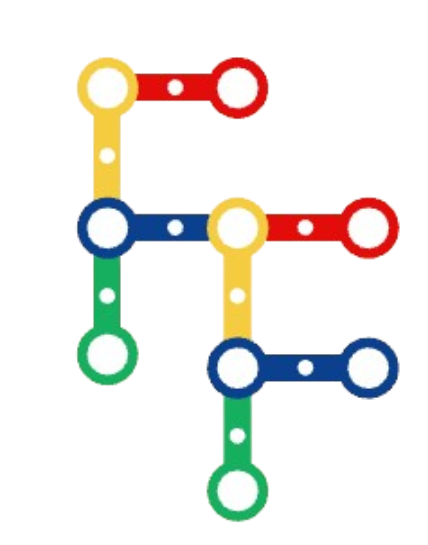

# FluxFlow

<p align="center">
  
</p>

<p align="center">
  <strong>Mobilidade inteligente e colaborativa para o transporte sobre trilhos.</strong>
</p>

---

## 1. Identificação do Projeto

**FluxFlow** é uma aplicação web gratuita voltada à melhoria da experiência dos passageiros do transporte público sobre trilhos. A plataforma busca facilitar o planejamento dos deslocamentos, oferecer informações operacionais e incentivar o compartilhamento de informações entre passageiros.

A solução tem como foco reduzir os impactos de problemas recorrentes, como atrasos, superlotação e falta de orientação durante os trajetos. Para isso, reúne recursos de consulta de linhas e estações, planejamento de rotas, previsão de lotação e informações colaborativas.

### Objetivo

O objetivo do FluxFlow é tornar as viagens de metrô e trem mais eficientes, previsíveis e confortáveis, ajudando o passageiro a tomar decisões melhores antes e durante o deslocamento.

### Funcionalidades principais

- **Status operacional:** consulta de informações operacionais relacionadas às linhas e estações.
- **Rotas inteligentes:** consulta de trajetos entre origem e destino, com critérios de escolha de rota.
- **Previsão de lotação:** consulta de previsões considerando data, horário, estação e linha.
- **Informações sobre linhas e estações:** consulta e gerenciamento de registros disponibilizados pela API.
- **Gestão de usuários:** cadastro, login, consulta, atualização e exclusão de usuários, conforme as operações disponibilizadas pela API.
- **Experiência informativa:** páginas institucionais, apresentação do sistema, perguntas frequentes e contato.

### Diferenciais propostos

- Foco no transporte sobre trilhos.
- Apoio à escolha de rotas de acordo com o critério desejado.
- Informações para auxiliar o planejamento da viagem.
- Proposta de colaboração entre passageiros, incluindo recursos visuais de mapa de calor e alertas apresentados na solução.

> **Observação:** algumas funcionalidades são apresentadas no site como proposta e protótipo. A disponibilidade efetiva de cada recurso depende dos dados e endpoints fornecidos pela API integrada.

---

## 2. Tecnologias Utilizadas

### Front-end

| Tecnologia | Utilização |
|---|---|
| React 19 | Construção da interface baseada em componentes. |
| TypeScript | Tipagem estática e maior previsibilidade do código. |
| Vite 8 | Ambiente de desenvolvimento e ferramenta de build. |
| Tailwind CSS 4 | Estilização da interface. |
| React Router | Navegação entre as páginas da aplicação. |
| React Hook Form | Gerenciamento e validação de formulários. |
| React Icons | Utilização de ícones na interface. |

### Back-end e integração

O Front-end consome uma API REST desenvolvida em Java, hospedada no Render:

- **API:** https://api-fluxflow.onrender.com/
- **Prefixo dos endpoints utilizados pelo Front-end:** `/fluxflow`

A comunicação é realizada por requisições HTTP utilizando `fetch`, com operações como `GET`, `POST`, `PUT` e `DELETE`, de acordo com cada funcionalidade.

---

## 3. Estrutura de Pastas

A organização principal do Front-end está dividida em componentes reutilizáveis, layouts, páginas, rotas e arquivos de configuração.

```text
FluxFlow/
├── public/
├── src/
│   ├── Components/
│   │   ├── Button/
│   │   ├── Card/
│   │   ├── Footer/
│   │   ├── Header/
│   │   └── ProtectedRoute/
│   ├── Layouts/
│   │   └── MainLayout.tsx
│   ├── Pages/
│   │   ├── Cadastro/
│   │   ├── Contato/
│   │   ├── Faq/
│   │   ├── Home/
│   │   ├── Login/
│   │   ├── NotFound/
│   │   ├── Principal/
│   │   ├── QuemSomos/
│   │   ├── Sistema/
│   │   ├── Sistema2/
│   │   └── Sobre/
│   ├── Routes/
│   │   └── AppRoutes.tsx
│   ├── img/
│   ├── App.tsx
│   ├── globals.css
│   └── main.tsx
├── index.html
├── package.json
├── package-lock.json
├── tsconfig.json
├── tsconfig.app.json
├── tsconfig.node.json
└── vite.config.ts
```

### Descrição das principais pastas

- **Components:** componentes reutilizáveis, como cabeçalho, rodapé e botões.
- **Layouts:** estrutura compartilhada entre as páginas.
- **Pages:** telas e funcionalidades organizadas por página.
- **Routes:** configuração das rotas e navegação da aplicação.
- **img:** imagens, logotipos e recursos visuais do projeto.

---

## 4. Como Executar o Projeto

### Pré-requisitos

Antes de iniciar, é necessário ter instalado:

- [Node.js](https://nodejs.org/) — versão compatível com as dependências do projeto.
- npm — instalado junto com o Node.js.
- Git — para clonar o repositório.

### 4.1. Clonar o repositório

```bash
git clone URL_DO_REPOSITORIO
```

Entre na pasta do projeto:

```bash
cd FluxFlow
```

### 4.2. Instalar as dependências

```bash
npm install
```

### 4.3. Executar em ambiente de desenvolvimento

```bash
npm run dev
```

Após iniciar, o Vite exibirá no terminal o endereço local para acessar a aplicação. Por padrão, normalmente é:

```text
http://localhost:5173
```

### 4.4. Gerar a versão de produção

Para verificar os tipos e gerar os arquivos otimizados:

```bash
npm run build
```

Os arquivos gerados serão disponibilizados na pasta `dist/`.

### 4.5. Visualizar a versão de produção localmente

Após executar o build:

```bash
npm run preview
```

### 4.6. Executar o lint

Para verificar problemas de lint no projeto:

```bash
npm run lint
```

---

## 5. Integração com a API Java

O FluxFlow realiza integração com a API Java hospedada no Render:

**URL base:** `https://api-fluxflow.onrender.com/fluxflow`

A integração está presente principalmente nas telas de cadastro, login e painel principal.

### Endpoints utilizados pelo Front-end

| Recurso | Método HTTP | Endpoint |
|---|---|---|
| Cadastro de usuário | POST | `/usuario` |
| Login | POST | `/usuario/login` |
| Listagem de usuários | GET | `/usuario` |
| Consulta de usuário | GET | `/usuario/{id}` |
| Atualização de usuário | PUT | `/usuario/{id}` |
| Exclusão de usuário | DELETE | `/usuario/{id}` |
| Logout | POST | `/usuario/logout` |
| Consulta de linhas | GET | `/linha` |
| Consulta de linha por ID | GET | `/linha/{id}` |
| Consulta de estações | GET | `/estacoes` |
| Consulta de estação por ID | GET | `/estacoes/{id}` |
| Linhas de uma estação | GET | `/estacoes/{id}/linhas` |
| Status operacional | GET | `/status-operacional` |
| Previsão de lotação | POST | `/previsoes-lotacao` |
| Consulta de rotas | GET | `/rotas` |

Os endpoints acima representam as rotas identificadas nas chamadas realizadas pelo Front-end. Parâmetros, formatos de requisição e respostas devem ser consultados na documentação oficial da API.

### Fluxo de integração

1. O usuário acessa uma funcionalidade no Front-end.
2. A aplicação coleta os dados necessários por meio da interface.
3. O Front-end envia uma requisição HTTP para a API Java.
4. A API processa a solicitação e retorna uma resposta.
5. A interface apresenta o resultado ou uma mensagem de erro ao usuário.

---

## 6. Páginas da Aplicação

| Rota | Página | Descrição |
|---|---|---|
| `/` | Início | Apresentação do FluxFlow e de seus principais recursos. |
| `/quem-somos` | Quem Somos | Apresentação da equipe de desenvolvimento. |
| `/sistema` | Sistema | Demonstração dos módulos de rotas, status, HeatMap e colaboração. |
| `/sistema2` | Sistema — detalhes | Explicação dos pilares e critérios da solução. |
| `/faq` | Perguntas frequentes | Respostas às dúvidas sobre a plataforma. |
| `/contato` | Contato | Formulário e canal de contato da equipe. |
| `/sobre` | Sobre | Contexto, objetivos e justificativa do projeto. |
| `/cadastro` | Cadastro | Criação de uma conta integrada à API. |
| `/login` | Login | Autenticação do usuário pela API. |
| `/principal` | Painel principal | Área de consultas e operações integradas à API. |

---

## 7. Links do Projeto

- **Repositório GitHub:** https://github.com/FluxFlow-GS-CitizenTech/Front-End
- **Aplicação publicada (Vercel):** https://fluxflow-six.vercel.app
- **API Java (Render):** https://api-fluxflow.onrender.com/
- **Vídeo de demonstração (YouTube):** https://youtu.be/omaVrdP4qnk

---

## 8. Equipe de Desenvolvimento


Projeto desenvolvido por:

| Foto | Integrante | GitHub | LinkedIn |
|---|---|---|---|
|  | Felipe Lima - RM569947 - 1TDSPH | [GitHub](https://github.com/felipelima2005) | [LinkedIn](https://www.linkedin.com/in/felipe-lima-a4215832a/) |
|  | Giovanni Zorzetto - RM569464 - 1TDSPH | [GitHub](https://github.com/Gizetto61) | [LinkedIn](https://www.linkedin.com/in/giovanni-zorzetto-oliveira-8375b9305/) |
|  | Raphael Gomes - RM572637 - 1TDSPH | [GitHub](https://github.com/PhaelRGB) | [LinkedIn](https://www.linkedin.com/in/raphaelbritorgb/) |

---

## 9. Vídeo de Demonstração

O vídeo de apresentação do FluxFlow deve demonstrar, em até três minutos:

- A proposta e o objetivo do projeto.
- A navegação pelas principais páginas.
- As funcionalidades de cadastro e login.
- O painel principal e as consultas disponíveis.
- A integração do Front-end com a API Java.
- As tecnologias utilizadas no desenvolvimento.

**Link do vídeo:** https://youtu.be/omaVrdP4qnk

---

## 10. Considerações Finais

O FluxFlow foi desenvolvido com a proposta de contribuir para uma mobilidade urbana mais inteligente, conectando passageiros a informações que auxiliem suas decisões durante o deslocamento no transporte sobre trilhos.

Por meio de uma interface construída com React e TypeScript e da integração com uma API Java, o projeto reúne recursos de consulta, planejamento e apresentação de informações sobre o sistema metroferroviário.

**FluxFlow — Mobilidade Inteligente & Colaborativa.**
